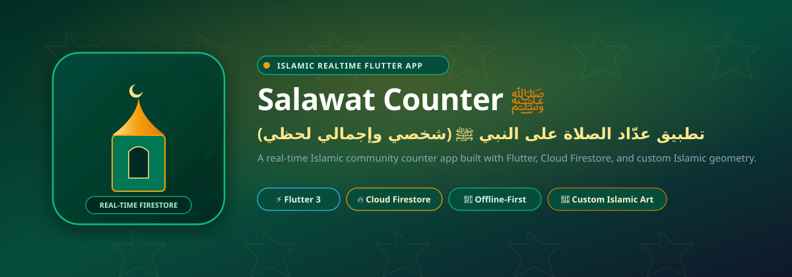
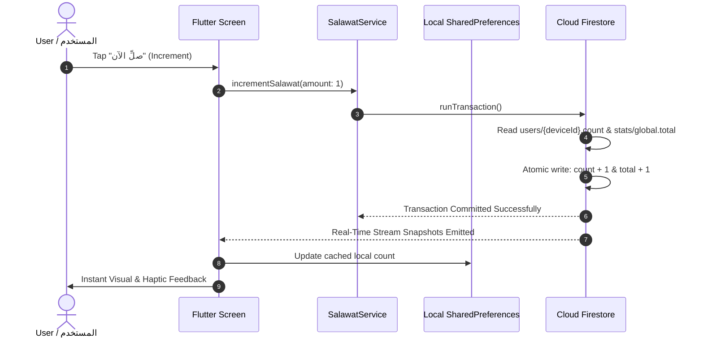
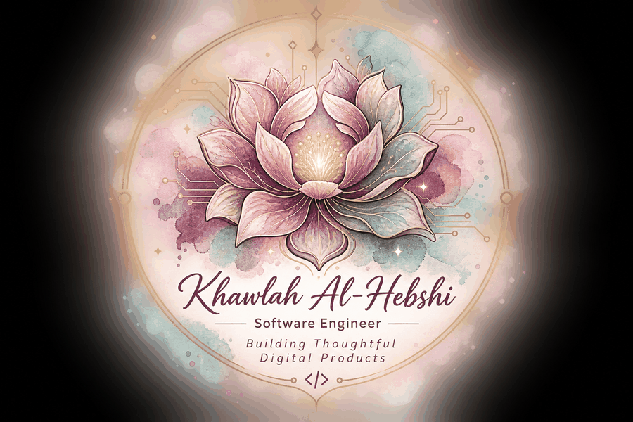

<div align="center">

  

  <br/><br/>

  <h1>Slow-at-counter- — عدّاد الصلاة على النبي ﷺ</h1>
  <p>
    <strong>A Real-Time Community Salawat Counter App with Live Cloud Firestore Sync &amp; Islamic Geometric Art</strong><br/>
    <em>تطبيق تفاعلي لحظي لعدّ الصلوات على النبي ﷺ (شخصي وإجمالي مشترك) عبر فايربيس فلوتر</em>
  </p>

  <p align="center">
    <a href="#-overview"></a>
    <a href="#-overview"></a>
    <a href="#-features"></a>
    <a href="#-features"></a>
    <a href="#-features"></a>
    <a href="#-license"></a>
  </p>

  <p align="center">
    <a href="#-overview">Overview</a> •
    <a href="#-key-features">Key Features</a> •
    <a href="#-system-architecture--database-schema">Architecture &amp; Schema</a> •
    <a href="#-getting-started--firebase-setup">Setup Guide</a> •
    <a href="#-project-structure">Project Structure</a> •
    <a href="#-about-the-developer">About the Developer</a>
  </p>

</div>

---

## 📌 Overview | نظرة عامة

### English
**Salawat Counter (Slow-at-counter-)** is a cross-platform mobile and web application built using **Flutter** and **Firebase Cloud Firestore**. It enables Muslims worldwide to keep a personal count of prayers upon the Prophet Muhammad ﷺ while contributing in real time to a live global community counter.

Designed with an **offline-first philosophy**, the app requires zero login authentication—generating a persistent anonymous device UUID. The user interface features authentic programmatic Islamic art: an eight-pointed Islamic star (`khatim`) drawn mathematically via Flutter's `CustomPainter`, overlaid on an ambient watercolor background of the Prophet's Mosque (*Al-Masjid An-Nabawi*).

### العربية
تطبيق **عدّاد الصلاة على النبي ﷺ (Slow-at-counter-)** هو تطبيق تفاعلي للأجهزة الذكية والويب مبني بإطار العمل **Flutter** مع قاعدة بيانات سحابية لحظية **Cloud Firestore**.

يتيح التطبيق لكل مسلم ومسلمة عدّ الصلوات على النبي ﷺ شخصياً مع المساهمة اللحظية في عدّاد إجمالي عام يجمع صلوات جميع المستخدمين حول العالم لحظة بلحظة. يتميز التطبيق بعدم الحاجة لأي تسجيل دخول (يعتمد على معرّف عشوائي مجهول وفريد لكل جهاز)، مع واجهة إسلامية راقية تحوي زخرفة هندسية إسلامية (نجمة ثمانية) مرسومة برمجياً بالكامل عبر الكود (`CustomPainter`).

---

## 🚀 Key Features | المميزات الرئيسية

- **🔄 Live Global & Personal Streams (مزامنة سحابية لحظية):**
  Listens to Firestore snapshot streams (`personalCountStream` and `globalTotalStream`) to update counts on screen instantaneously as people pray across the globe.

- **⚡ Atomic Multi-Document Transactions (معاملات ذرية مانعة للتضارب):**
  Uses `FirebaseFirestore.instance.runTransaction` so that whenever a user taps the counter, both the user's personal count and the global grand total are updated atomically without race conditions.

- **📱 Offline-First & Zero Friction Login (بدون تسجيل دخول):**
  No account creation or passwords needed. The app generates a persistent `uuid.v4` stored in `SharedPreferences`, caching local counts so the app renders immediately even before network connections resolve.

- **🎨 Programmatic Islamic Geometry (زخرفة إسلامية مرسومة بالكود):**
  The central eight-pointed Islamic star and ornamental borders are drawn purely with vector canvas math in `IslamicPatternPainter`, ensuring crystal-clear sharpness on any screen resolution.

- **🌍 Native Arabic RTL Support (دعم كامل للعربية والاتجاه من اليمين لليسار):**
  Integrated with `flutter_localizations` and tuned with Islamic aesthetic colors (Emerald `#064E3B`, Gold `#D97706`, and Soft Amber `#FEF3C7`).

---

## 🏗 System Architecture & Database Schema | المعمارية وقاعدة البيانات

### Firestore Schema

```text
cloud_firestore/
├── users/
│   └── {deviceId}/                 # Anonymous Device UUID
│       ├── count: int             # Personal Salawat count
│       └── updatedAt: timestamp   # Server timestamp
└── stats/
    └── global/                     # Shared Global Stats
        └── total: int             # Aggregate total across all devices
```

### Atomic Transaction Workflow (Mermaid Diagram)



---

## 📥 Getting Started & Firebase Setup | دليل التثبيت والتشغيل

### Prerequisites
* **Flutter SDK 3.3+**: (`flutter --version` to check).
* **Firebase Account**: A free project on the [Firebase Console](https://console.firebase.google.com) (Spark plan).

---

### Step 1: Clone Repository & Install Dependencies

```bash
git clone https://github.com/khowlah/Slow-at-counter-.git
cd Slow-at-counter-

# Generate platform folders if building for mobile
flutter create --org com.yourcompany --platforms=android,ios .

# Fetch dependencies
flutter pub get
```

---

### Step 2: Configure Firebase (إعداد فايربيس)

1. Create a Firebase Project on [Firebase Console](https://console.firebase.google.com).
2. Enable **Firestore Database** in production mode.
3. Apply the provided security rules from `firestore.rules` into the **Rules** tab in the console:
   ```javascript
   rules_version = '2';
   service cloud.firestore {
     match /databases/{database}/documents {
       match /users/{deviceId} {
         allow read, write: if true;
       }
       match /stats/global {
         allow read, write: if true;
       }
     }
   }
   ```
4. Run FlutterFire CLI to generate valid credentials:
   ```bash
   dart pub global activate flutterfire_cli
   flutterfire configure
   ```

---

### Step 3: Run the Application

```bash
# Run on connected device, emulator, or Chrome
flutter run
```

---

## 📁 Project Structure | هيكل المشروع

```text
Slow-at-counter-/
├── assets/
│   ├── branding/                          # Visual identity & developer signature
│   │   ├── banner.svg                     # High-res Islamic project banner
│   │   ├── khawlah-signature-animated.gif # Animated floral signature
│   │   └── khawlah-signature.png          # Static developer signature
│   └── images/
│       └── masjid_nabawi.jpg              # Watercolor painting background
├── lib/
│   ├── screens/
│   │   └── home_screen.dart               # Interactive main counter page
│   ├── services/
│   │   └── salawat_service.dart           # Firestore transactions & stream logic
│   ├── theme/
│   │   └── app_theme.dart                 # Emerald & Gold Islamic palette
│   ├── widgets/
│   │   ├── islamic_pattern_painter.dart   # Vector 8-pointed star geometric painter
│   │   └── stat_card.dart                 # Real-time counter cards
│   ├── firebase_options.dart              # Firebase platform config
│   └── main.dart                          # Application entry point & RTL setup
├── firestore.rules                        # Suggested Firestore security rules
├── pubspec.yaml                           # Flutter dependencies & assets manifest
└── README.md                              # Comprehensive documentation
```

---

<!-- 🌸 KHAWLAH AL-HEBSHI — DEVELOPER SIGNATURE -->
## 👩‍💻 About the Developer | عن المطوّرة

<div align="center">

  

  <br/>

  

  <br/><br/>

  <a href="https://github.com/khowlah">
    
  </a>
  <a href="https://linkedin.com/in/khawlah-al-hebshi-12046a38a">
    
  </a>
  <a href="https://khowlah.github.io/Myprotofile">
    
  </a>

  <br/><br/>

  
  
  
  

  <br/><br/>

  <i>Designed with curiosity. Built with purpose.</i>
  <br/>
  <sub>✦ A little signature from Khawlah ✦</sub>

</div>

<br/>

### English
I'm **Khawlah Al-Hebshi**, a Software Engineering graduate working across backend development with **Next.js** and cross-platform applications with **Flutter**. I bring together software engineering, product thinking, and AI-assisted workflows to build practical, impactful digital experiences.

I use AI and vibe coding as core accelerators in the development process, while keeping relentless focus on clean architecture, sound problem-solving, and products that serve real human needs.

### العربية
أنا **خولة الحيشي**، خريجة هندسة برمجيات أعمل على تطوير الأنظمة الخلفية عبر **Next.js** والتطبيقات متعددة المنصات عبر **Flutter**. أدمج بين المبادئ الهندسية المتينة، والتفكير المتمحور حول المنتج، ومسارات العمل المدعومة بالذكاء الاصطناعي لبناء تجارب رقمية عملية ومتقنة تخدم المجتمع.

---

## 📄 License | الترخيص

This project is open-source and distributed under the **MIT License**.

<div align="center">
  <sub>اللهم صلّ وسلّم وبارك على نبينا محمد وعلى آله وصحبه أجمعين ﷺ</sub><br/>
  <sub>Built with care &amp; devotion by Khawlah Al-Hebshi 🌸</sub><br/>
  <a href="#slow-at-counter----عدّاد-الصلاة-على-النبي-ﷺ">Back to Top ⬆️</a>
</div>
